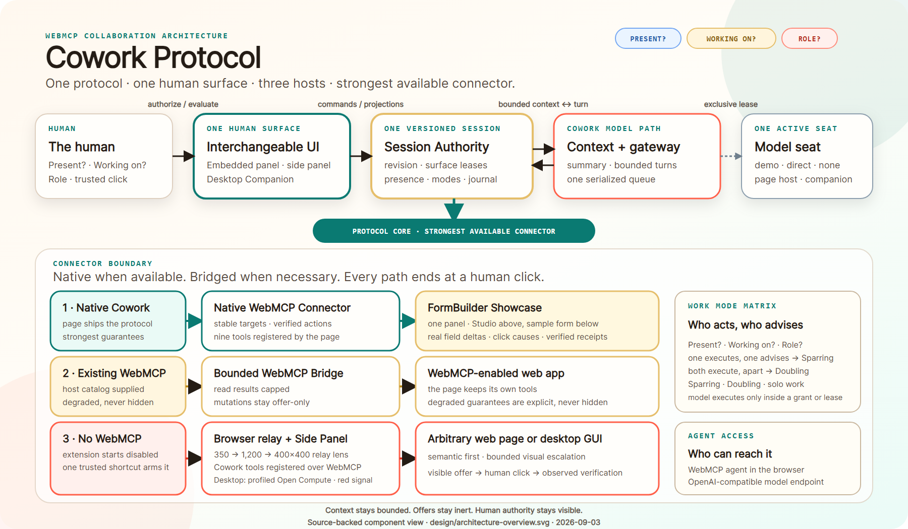
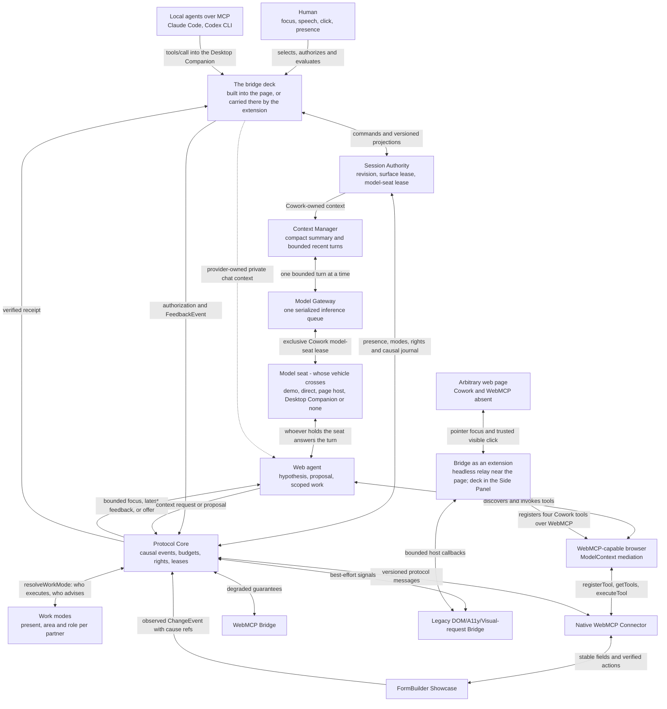

# Cowork Protocol
**English** · [Deutsch](README_de.md)


Cowork Protocol is a small collaboration contract for people and web agents. It gives an agent the smallest useful context, makes proposed changes visible, keeps human clicks distinct from agent calls, and supports tightly scoped solo work while the human is away.

> Native when available. Bridged when necessary.

**[Try the live showcase](https://ellmos-ai.github.io/cowork-protocol/apps/formbuilder-showcase/)** · **[Watch the demo video](https://youtu.be/9CJehV7Bugk)** · [Three in one: two bridges, one vehicle](docs/hosts.md) · [Architecture](docs/architecture.md) · [Work modes](docs/work-modes.md) · [Panel tour](docs/panel-tour.md) · [Agent guide](docs/agent-guide.md) · [How to use it](docs/panel-tour.md#walkthrough-one-session-start-to-finish) · [Evidence ledger](docs/evidence.md) · [Outlook](docs/outlook.md) · [Pre-existing and new work](PREEXISTING-AND-NEW.md)

**Install it with your AI assistant:** hand [docs/install-with-your-assistant.md](docs/install-with-your-assistant.md) to Claude Code, Codex CLI or a comparable agent and say "install this for me". [`llms.txt`](llms.txt) is the machine-readable index.

## Three in one: two bridges with a place, one vehicle

The protocol is the submission; everything else here exists to show it holds up
wherever the human happens to be. A **bridge** has a place: it sits between one
page and one model, and it is where you see what the model sees and where the
click happens. A **vehicle** carries a model across it. Building the bridge
twice is the whole argument — once where a page invites it, once where a page
knows nothing about it.

1a. **The rails alone** — the packages, wired into your own app's own UI. The contract without a single Cowork pixel, and no bridge yet.
1b. **The bridge, built into the page** — one instrument the page itself renders, no install. The live showcase runs at this level.
2. **The same bridge, as a browser extension** — it carries that deck onto pages that built none, registering the same Cowork tools over WebMCP. Not a second product: on a page that has its own bridge, it steps aside.
3. **Desktop Companion — the vehicle** — an app window without an extension: freer, not tied to one browser, with a filtered Computer Use fallback. It holds the session's model seat and drives that model over the bridge it is connected to.

Only what runs on the rails crosses: an agent that does not speak the protocol
does not get over. A bridge with nothing on it says so — *No model is crossing
the bridge.*

[](docs/architecture.md)

The same system as a source-backed flow; the component detail lives in
[docs/architecture.md](docs/architecture.md).



The protocol and the UI are separate products. A website decides whether it
ships no page UI, an automatic operator-selected UI, or a user-activated
optional UI. Cowork's page panel, Extension Side Panel and Companion are only
reference clients; Codex, Claude and other compatible provider surfaces can use
the same collaboration infrastructure while retaining their own chat context.
That path is a designed contract with a test client behind it, not a measured
run: no session by a shipped third-party agent has been observed yet.
Websites may deliberately embed the Cowork reference UI as their selected
consumer, giving users the same collaboration path without installing the
extension; FormBuilder demonstrates this `protocol-and-ui` mode.
The runtime independently chooses the strongest connector the current page
actually provides: native Cowork, a bounded bridge for existing WebMCP tools,
or the default-off browser relay for a page without WebMCP. The
[architecture document](docs/architecture.md) and accepted
[post-audit session architecture](docs/post-audit-session-architecture.md)
record the detailed contract and migration path.

## What changes for the person filling in the form

**Before.** An agent that wants to help with a form has two poor options. It can
read the whole page and spend its context on markup nobody looks at, or it can
act on a guess. In both cases the person cannot see what the agent is about to
do, and an agent that is able to act at all is able to act unasked. Every turn
adds to a transcript that keeps growing, so the longer the collaboration lasts,
the more it costs and the less it focuses.

**After.** The person points at one field. The agent receives a focus packet
capped at 350 code units — that field, its stable ID and the capabilities that
actually apply to it — instead of the page. If that is not enough, it can
request exactly one further bounded context level, and it has to give a reason.
The agent then proposes an exact, human-readable value, and the input stays
unchanged: the proposal cannot authorize itself. The value is applied by the
person's real click, and the app answers with a receipt naming the offer and the
click that caused it. Feedback and changes are read back latest-only, so the
agent sees the current state rather than an ever-growing history. When the
person steps away, they hand over a lease scoped to one field with a call budget
and an expiry; the agent may continue only inside it, and the lease ends when the
page changes. Silence and unchanged state produce no packet at all.

## Why WebMCP

The agent reads a structured `cowork_read_focus` tool instead of guessing from the whole interface. FormBuilder contributes a stable target ID and only the capabilities relevant to that field. User-authored text is marked untrusted, selected text over 160 JavaScript UTF-16 code units becomes a length plus digest, and normal focus text is capped at 350 code units.

## What the prototype does today

- **Bounded attention instead of page dumps.** Character-capped focus packets, a
  digest for long selections, and one reasoned, one-shot context request capped
  at 1,200 adapter characters. Silence and unchanged state emit nothing.
- **Offers cannot authorize themselves and carry an attributed author.** An
  agent proposes an exact visible value; only a real human click applies it, and
  every change comes back as a causal, latest-only receipt with
  click-authenticated feedback. Every offer and receipt names its author — the
  seat model, a named MCP client, or a WebMCP agent calling in the page — read
  from the call as it arrives, so none of the nine tool schemas had to grow a
  field. Naming an author is not granting rights: the right to propose is still
  the one model seat's, and the right to execute is still a person's click.
- **Three questions instead of a settings panel.** Each partner answers who is
  here, on what, and in which role - executing or advising. The work mode and the
  click right follow; nothing chooses action rights separately. A model executes
  only inside a versioned, budgeted, expiring grant or lease, so "away" never
  means "unattended" and a present human is never a substitute for the record.
  See [docs/work-modes.md](docs/work-modes.md).

  [](docs/work-modes.md)
- **One conversation across surfaces, in one voice.** Page panel, extension
  Side Panel and desktop Companion share a single versioned session; an optional
  same-origin model host attaches a preferred model while endpoint and key stay
  on the server, never in the browser. One speaker serves every surface, says
  each announcement once and stays silent on the page while the Companion window
  holds the session, so two open windows do not answer over each other. Joining
  the Companion is reversible: **Leave Companion** hands the session back to the
  page, which becomes its own authority again from its own last revision.
- **A model that fails says so.** When a reply cannot be used the panel prints
  the reason with its code — `NO_MODEL_CONNECTED`, `MODEL_UNAVAILABLE`,
  `INVALID_MODEL_SUGGESTION` — and an excerpt of what came back, instead of
  quietly showing nothing. A model that answers in prose rather than with an
  offer is not discarded either: the prose becomes the conversation's message,
  which is also what gets spoken.
- **Three connector paths, each labeled honestly.** Native Cowork first, then a
  bounded bridge over existing WebMCP tools, then a default-off relay for pages
  without WebMCP — every step reports its reduced guarantees instead of pretending
  they are equal.
- **A working showcase, not a mock.** The FormBuilder journey runs the real
  contracts end to end: attention lens, work modes, offers, receipts, feedback,
  authority handover, solo leases and typed or spoken conversation.

The component-level detail behind each point is in
[docs/architecture.md](docs/architecture.md) and in the [Packages](#packages)
list below; what is proven versus still open is recorded under
[Evidence and boundaries](#evidence-and-boundaries).

## Run the local showcase

Requirements: Node.js 22 or newer.

```powershell
npm start
```

Then open `http://127.0.0.1:4173/apps/formbuilder-showcase/` in a WebMCP-capable browser.

### Connect a preferred model without browser secrets

The optional host accepts an OpenAI-compatible chat-completions endpoint. Provider behavior may vary, so a real endpoint still needs its own acceptance run.

```powershell
$env:COWORK_MODEL_ENDPOINT='http://127.0.0.1:11434/v1/chat/completions'
$env:COWORK_MODEL_ID='your-model-id'
$env:COWORK_MODEL_API_KEY='optional-server-only-key'
$env:COWORK_MODEL_REASONING_EFFORT='none' # optional: none, low, medium, high, max
$env:COWORK_MODEL_MAX_TOKENS='200' # optional: 64–500; default 500
$env:COWORK_MODEL_TIMEOUT_MS='120000' # optional; maximum 120000
npm run start:model
```

Open the same local URL. The panel changes from `Local demo helper` to `Connected model bridge` only after same-origin discovery succeeds. The browser sends just `{ protocolVersion, turn }`; endpoint, model ID and API key stay in the server process. See [docs/model-host.md](docs/model-host.md).

## Verify the slice

```powershell
npm test
npm run demo:adapter
npm run eval
npm run proof
npm run check:architecture
npm run check:secrets
npm run build:companion
npm run smoke:companion
npm run smoke:companion-cockpit
npm run smoke:companion-mcp
npm run smoke:companion-native
npm run smoke:companion-webmcp
npm run smoke:model-host
npm run smoke:webmcp
npm run smoke:surface
npm run smoke:accessibility
npm run smoke:builder
npm run smoke:contrast
```

The suite uses Node's built-in test runner and has no external runtime dependency. What each command proves, and where its boundary lies, is described under [Evidence and boundaries](#evidence-and-boundaries).

## Run the no-extension Desktop Companion

The Companion persists sessions, opens a movable Edge/Chrome app window by
default and starts the presence-colored Windows tray icon. A preferred model is
optional; without one the session UI and handoff remain available while model
input is disabled.

```powershell
$env:COWORK_ALLOWED_ORIGINS='http://127.0.0.1:4173,https://ellmos-ai.github.io'
$env:COWORK_MODEL_ENDPOINT='http://127.0.0.1:11434/v1/chat/completions' # optional
$env:COWORK_MODEL='your-model-id'                                      # optional
npm run start:companion-host
```

Set `COWORK_OPEN_WINDOW=0` or `COWORK_TRAY=0` to disable either presentation.
Set `COWORK_COMPUTER_USE=0` to remove the lazy Open Compute fallback. It defaults
to the non-executing `confirm` safety ceiling; see
[apps/desktop-companion/README.md](apps/desktop-companion/README.md) for the
explicit operator override and the bundled token-filter profile.

## Model seat

One switch decides who answers in the showcase, instead of demo behaviour spread
over several buttons. `apps/formbuilder-showcase/src/model-seat.js` resolves it
in a fixed order and labels the result honestly:

- **Demo mode on** — a disclosed scripted helper answers and proposes fixed
  values. It is labeled `Demo helper (scripted)`; nothing there comes from a
  language model.
- **Demo mode off** — an injected model transport wins first, then a direct
  browser connection to an OpenAI-compatible endpoint (a local Ollama or LM
  Studio from a locally served copy; on the HTTPS Pages deployment the endpoint
  must itself be `https://`), then a same-origin model host started with
  `npm run start:model`.
- **Nothing connected** — the seat says so and proposes nothing. The turn is
  still published for a WebMCP agent, which answers it through `cowork_read_turn`
  and `cowork_reply_turn`. There is no silent fallback to the script: outside
  demo mode `builder-model-suggester.js` raises on a missing, malformed or
  duplicate model answer rather than displaying a suggestion that only looks
  like the model worked.

While the Desktop Companion is connected it holds the session's model seat and
answers for the whole session. The switch and its endpoint fields live in the
page's **Model seat** panel (`apps/formbuilder-showcase/index.html`); the API key
is kept in the tab only, never in the page's persistent storage.

### The four levels

The same versioned session is reachable from four levels, and the names are not
interchangeable:

| Level | What it is | Bridge or vehicle |
| --- | --- | --- |
| 1a | the packages, wired into your own app's own UI. No Cowork surface at all | neither: the rails, with nothing built on them |
| 1b | the bridge the page builds into itself, no install. This showcase runs at this level | bridge |
| 2 | the Cowork Protocol Bridge, Chrome's side panel outside the page DOM, for pages that built none | the same bridge, carried onto a foreign page |
| 3 | the Desktop Companion: loopback app window with a Windows tray icon, no extension | vehicle: it holds the model seat and drives it over a bridge |

## Build the optional browser extension

```powershell
npm run build:companion
```

Load the generated `dist-browser-companion` directory as an unpacked extension. It is a separate optional adapter artifact and is not included in the Pages deployment. See [apps/browser-companion/README.md](apps/browser-companion/README.md).

## Build the web-only release

```powershell
npm run build:pages
npm run preview:pages
```

The allowlisted `dist/` artifact contains only the browser showcase and required runtime modules. The included GitHub Pages workflow is manual-only; neither a local build nor a later push deploys automatically. See [docs/deployment.md](docs/deployment.md).

## Native WebMCP tools

- `cowork_read_focus` returns the current character-bounded focus packet.
- `cowork_request_context` returns one reasoned, target-bound related-context level capped at 1,200 adapter characters.
- `cowork_offer_action` creates a visible offer; it never authorizes or executes the change.
- `cowork_read_presence` returns the explicit human/agent work mode in the published 0.1 vocabulary; the derived matrix state is carried alongside it.
- `cowork_execute_solo` executes only inside a valid, scoped and unexpired solo lease.
- `cowork_read_changes` returns only the latest digest-based causal change while the lens is enabled.
- `cowork_read_feedback` returns only the latest bounded, click-authenticated human evaluation.
- `cowork_read_turn` returns only the latest pending bounded human conversation turn.
- `cowork_reply_turn` returns bounded text and at most three visible offers for that exact turn; it never executes an offer.

## Packages

Cowork separates protocol state and bounded turns from its surface connectors and reference applications. The
links below open the source directories; the [component reference](docs/components.md#packages) keeps the full
module map and responsibilities.

- **State and turns:** [packages/core](packages/core/) · [packages/conversation](packages/conversation/) ·
  [packages/context-manager](packages/context-manager/) ·
  [packages/session-authority](packages/session-authority/) · [packages/model-gateway](packages/model-gateway/)
  · [packages/companion-link](packages/companion-link/).
- **Surfaces and connectors:** [packages/model-transport](packages/model-transport/) ·
  [packages/native-webmcp](packages/native-webmcp/) ·
  [packages/integration-contract](packages/integration-contract/) ·
  [packages/reference-ui](packages/reference-ui/) · [packages/bridge](packages/bridge/) ·
  [packages/open-compute-adapter](packages/open-compute-adapter/) · [packages/evals](packages/evals/) ·
  [packages/formbuilder-connector](packages/formbuilder-connector/).
- **Reference applications:** [apps/browser-companion](apps/browser-companion/) ·
  [apps/desktop-companion](apps/desktop-companion/) · [apps/formbuilder-showcase](apps/formbuilder-showcase/).
  The component reference also maps the FormBuilder Studio and Cowork adapter files.

## Data-flow boundaries

The Browser Bridge does not load remote code or itself send page context to a remote server. A WebMCP agent or
configured companion/model endpoint may receive context selected or requested through the protocol. The Desktop
Companion accepts a configurable HTTP(S) endpoint and may send an optional bearer key to it; an HTTP endpoint
does not encrypt that upstream connection. Speech recognition and synthesis use browser APIs, and their
processing location depends on the browser and its provider. See [docs/hosts.md](docs/hosts.md),
[docs/model-host.md](docs/model-host.md) and [docs/evidence.md](docs/evidence.md) for the implementation and
evidence boundaries.
## Evidence and boundaries

This section records what has actually been observed and where each claim stops.
The full ledger, including its commit trail and the explicitly unproven items,
is in [docs/evidence.md](docs/evidence.md).

### Accepted browser runs

Five Edge 154 browser smokes passed in the 2026-10-13 care run. Chrome was unavailable, so this run did not test it. The detailed, dated browser records and their limits are in the [evidence ledger](docs/evidence.md#accepted-browser-runs); they document observed runs, not a promise of current coverage.
### What each check proves

The deterministic core runs (`demo:adapter`, `eval` and `proof`) verify protocol contracts, not a live browser host. Browser and surface smokes use isolated profiles and fixtures; provider-backed acceptance is opt-in. The full command contracts are in [docs/testing.md](docs/testing.md#what-each-check-proves), and dated browser records are in the [evidence ledger](docs/evidence.md#accepted-browser-runs).
### Scope of the imported showcase

Only the browser-based portion of the pre-existing FormBuilder belongs to the
imported showcase scope; its old desktop, Python and packaging code remains
excluded. The new Cowork Desktop Companion is a separate protocol client in
this repository.

## Outlook

What is here is the submission, and it is not the finished thought. A long
acceptance session the day before the deadline produced more work than a
deadline can hold: an agent that acts seeing the whole page and steering its own
attention instead of reading a lens, rights held per agent rather than one model seat for
everyone, a page that can ship a skill and not only a tool catalog, memory for
the seat model, a choice of who answers a turn, and a general WebMCP injector
for pages that carry none.

Those are intentions, not claims. None of them is built, and the measured state
of this repository is the [evidence ledger](docs/evidence.md) rather than this
paragraph. [docs/outlook.md](docs/outlook.md) says what each one is, what
already exists underneath it, and why it was left undone.

## License

MIT. The repository-wide license applies to new work here, including the showcase integration. The imported FormBuilder engine keeps its original MIT notice; its provenance is recorded in [apps/formbuilder-showcase/FORMBUILDER-NOTICE.md](apps/formbuilder-showcase/FORMBUILDER-NOTICE.md) and [PREEXISTING-AND-NEW.md](PREEXISTING-AND-NEW.md).
