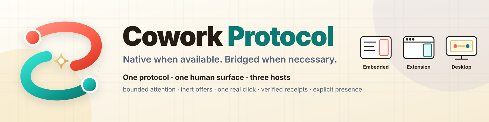
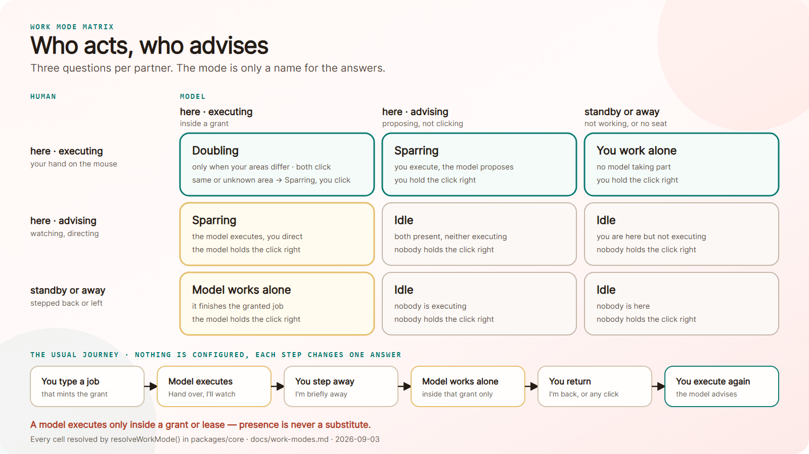

# Cowork Protocol

[English](README.md) · **Deutsch**

Cowork Protocol ist ein schlanker Kollaborationsvertrag für Menschen und Web-Agenten. Er gibt einem
Agenten nur den nötigen Kontext, macht Änderungsvorschläge sichtbar, trennt menschliche Klicks von
Agentenaufrufen und ermöglicht eng begrenzte Einzelarbeit, während der Mensch abwesend ist.

> Nativ, wenn verfügbar. Über eine Brücke, wenn nötig.

**[Live-Showcase ausprobieren](https://ellmos-ai.github.io/cowork-protocol/apps/formbuilder-showcase/)**
· **[Demovideo ansehen](https://youtu.be/9CJehV7Bugk)** · [Drei in einem: zwei Brücken mit einem Platz,
ein Fahrzeug](docs/hosts.md) · [Architektur](docs/architecture.md) · [Arbeitsmodi](docs/work-modes.md) ·
[Rundgang durch das Panel](docs/panel-tour.md) · [Agentenleitfaden](docs/agent-guide.md) · [So verwendest
du es](docs/panel-tour.md#walkthrough-one-session-start-to-finish) · [Belegübersicht](docs/evidence.md) ·
[Ausblick](docs/outlook.md) · [Vorhandene und neue Arbeit](PREEXISTING-AND-NEW.md)

**Mit deinem KI-Assistenten installieren:** Gib
[docs/install-with-your-assistant.md](docs/install-with-your-assistant.md) Claude Code, Codex CLI oder
einem vergleichbaren Agenten und sage: „Installiere das für mich.“ [`llms.txt`](llms.txt) ist der
maschinenlesbare Index.

## Drei in einem: zwei Brücken mit einem Platz, ein Fahrzeug

Das Protokoll ist die Einreichung; alles andere hier zeigt, dass es sich an den verschiedenen Orten
bewährt, an denen sich ein Mensch aufhalten kann. Eine **Brücke** hat einen festen Platz: Sie liegt
zwischen einer Seite und einem Modell. Dort ist sichtbar, was das Modell sieht und wo der Klick erfolgt.
Ein **Fahrzeug** bringt ein Modell über die Brücke. Die Brücke zweimal zu bauen, ist das ganze Argument:
einmal dort, wo eine Seite sie einlädt, und einmal dort, wo eine Seite nichts davon weiß.

1a. **Nur die Schienen** — die Pakete, eingebunden in die Benutzeroberfläche deiner eigenen App. Der
Vertrag ohne ein einziges Cowork-Pixel und noch ohne Brücke. 1b. **Die in die Seite eingebaute Brücke** —
ein Werkzeug, das die Seite selbst darstellt; keine Installation. Das Live-Showcase läuft auf dieser
Ebene.
2. **Dieselbe Brücke als Browsererweiterung** — sie trägt das Panel auf Seiten, die selbst keines gebaut haben, und registriert dieselben Cowork-Werkzeuge über WebMCP. Es ist kein zweites Produkt: Hat eine Seite bereits ihre eigene Brücke, tritt die Erweiterung zurück.
3. **Desktop Companion — das Fahrzeug** — ein App-Fenster ohne Erweiterung: freier nutzbar, nicht an einen Browser gebunden und mit einem gefilterten Computer-Use-Fallback. Es hält den Modellplatz der Sitzung und steuert das Modell über die Brücke, mit der es verbunden ist.

Nur was auf den Schienen fährt, kommt hinüber: Ein Agent, der das Protokoll nicht spricht, kommt nicht
weiter. Eine Brücke ohne Fahrzeug sagt es offen: *Kein Modell fährt über die Brücke.*

Derselbe Aufbau als quellengestützter Ablauf; die Details der Komponenten stehen im
[Architekturdokument](docs/architecture.md).

~~~mermaid
flowchart TB
  HUMAN["Human\nfocus, speech, click, presence"]
  AGENT["Web agent\nhypothesis, proposal, scoped work"]
  BROWSER["WebMCP-capable browser\nModelContext mediation"]
  SURFACES["The bridge deck\nbuilt into the page, or carried there by the extension"]
  SESSION["Session Authority\nrevision, surface lease, model-seat lease"]
  CONTEXT["Context Manager\ncompact summary and bounded recent turns"]
  GATEWAY["Model Gateway\none serialized inference queue"]
  CORE["Protocol Core\ncausal events, budgets, rights, leases"]
  MODE["Work modes\npresent, area and role per partner"]
  SEAT["Model seat - whose vehicle crosses\ndemo, direct, page host, Desktop Companion or none"]
  LOCALAGENTS["Local agents over MCP\nClaude Code, Codex CLI"]
  NATIVE["Native WebMCP Connector"]
  WEBBRIDGE["WebMCP Bridge"]
  LEGACY["Legacy DOM/A11y/Visual-request Bridge"]
  EXTENSION["Bridge as an extension\nheadless relay near the page; deck in the Side Panel"]
  LEGACYPAGE["Arbitrary web page\nCowork and WebMCP absent"]
  FORM["FormBuilder Showcase"]

  HUMAN -->|"selects, authorizes and evaluates"| SURFACES
  SURFACES <-->|"commands and versioned projections"| SESSION
  SESSION -->|"Cowork-owned context"| CONTEXT
  CONTEXT <-->|"one bounded turn at a time"| GATEWAY
  GATEWAY <-->|"exclusive Cowork model-seat lease"| SEAT
  SEAT <-->|"whoever holds the seat answers the turn"| AGENT
  SURFACES -.->|"provider-owned private chat context"| AGENT
  SESSION <-->|"presence, modes, rights and causal journal"| CORE
  CORE <-->|"resolveWorkMode: who executes, who advises"| MODE
  SURFACES -->|"authorization and FeedbackEvent"| CORE
  CORE -->|"bounded focus, latest feedback, or offer"| AGENT
  AGENT -->|"context request or proposal"| CORE
  AGENT <-->|"discovers and invokes tools"| BROWSER
  BROWSER <-->|"registerTool, getTools, executeTool"| NATIVE
  CORE -->|"verified receipt"| SURFACES
  CORE <--> |"versioned protocol messages"| NATIVE
  CORE <--> |"degraded guarantees"| WEBBRIDGE
  CORE <--> |"best-effort signals"| LEGACY
  LEGACYPAGE <-->|"pointer focus and trusted visible click"| EXTENSION
  EXTENSION <-->|"bounded host callbacks"| LEGACY
  EXTENSION -->|"registers four Cowork tools over WebMCP"| BROWSER
  LOCALAGENTS -->|"tools/call into the Desktop Companion"| SURFACES
  NATIVE <--> |"stable fields and verified actions"| FORM
  FORM -->|"observed ChangeEvent with cause refs"| CORE
~~~

Das Protokoll und die Benutzeroberfläche sind getrennte Produkte. Eine Website entscheidet, ob sie keine
Seitenoberfläche, eine automatisch vom Betreiber ausgewählte Oberfläche oder eine optionale, vom Nutzer
aktivierte Oberfläche bereitstellt. Coworks Seitenpanel, Browser-Seitenleiste und Companion sind
Referenz-Clients. Codex, Claude und andere kompatible Anbieteroberflächen können dieselbe
Kollaborationsinfrastruktur nutzen und dabei ihren eigenen Chat-Kontext behalten. Dieser Weg ist ein
entworfener Vertrag mit einem Test-Client, kein gemessener Lauf: Eine Sitzung mit einem ausgelieferten
Drittanbieter-Agenten wurde bisher nicht beobachtet. Websites können die Cowork-Referenzoberfläche
bewusst als ausgewählten Client einbetten und damit denselben Kollaborationsweg ohne Browsererweiterung
anbieten; FormBuilder zeigt diesen Modus protocol-and-ui. Die Laufzeit wählt unabhängig die stärkste
Verbindung, die die aktuelle Seite tatsächlich bereitstellt: natives Cowork, eine begrenzte Brücke über
vorhandene WebMCP-Werkzeuge oder den standardmäßig deaktivierten Browser-Relay für Seiten ohne WebMCP.
Das [Architekturdokument](docs/architecture.md) und die freigegebene
[Post-Audit-Sitzungsarchitektur](docs/post-audit-session-architecture.md) halten Vertrag und
Migrationsweg fest.

## Was sich für die Person beim Ausfüllen des Formulars ändert

**Vorher.** Ein Agent, der bei einem Formular helfen soll, hat zwei schlechte Möglichkeiten. Er kann die
ganze Seite lesen und Kontext für Markup verbrauchen, das niemand anschaut, oder er kann auf Verdacht
handeln. In beiden Fällen kann die Person nicht sehen, was der Agent vorhat. Und wenn ein Agent überhaupt
handeln kann, kann er auch ohne Nachfrage handeln. Jede Runde vergrößert das Transkript; je länger die
Zusammenarbeit dauert, desto mehr kostet sie und desto weniger bleibt sie fokussiert.

**Nachher.** Die Person zeigt auf ein Feld. Der Agent erhält statt der ganzen Seite ein Fokuspaket mit
höchstens 350 Codeeinheiten: dieses Feld, seine stabile ID und nur die dafür geltenden Fähigkeiten.
Reicht das nicht, kann er genau eine weitere, begrenzte Kontextebene anfordern und muss den Grund nennen.
Anschließend schlägt der Agent einen genauen, für Menschen lesbaren Wert vor; die Eingabe bleibt
unverändert, denn der Vorschlag kann sich nicht selbst freigeben. Erst der echte Klick der Person
übernimmt den Wert. Die App erstellt einen Beleg, der das Angebot und den auslösenden Klick benennt.
Feedback und Änderungen werden nur im neuesten Stand zurückgegeben, damit der Agent den aktuellen Zustand
statt eines immer längeren Verlaufs sieht. Wenn die Person weggeht, übergibt sie eine auf ein Feld
begrenzte Berechtigung mit Aufrufbudget und Ablaufzeit. Der Agent darf nur innerhalb dieser Berechtigung
weiterarbeiten; sie endet, sobald sich die Seite ändert. Schweigen und ein unveränderter Zustand erzeugen
überhaupt kein Paket.

## Warum WebMCP

Der Agent liest das strukturierte Werkzeug cowork_read_focus, statt die ganze Oberfläche zu erraten.
FormBuilder liefert eine stabile Ziel-ID und nur die Fähigkeiten, die für dieses Feld gelten. Vom Nutzer
verfasster Text ist als nicht vertrauenswürdig gekennzeichnet. Ausgewählter Text mit mehr als 160
JavaScript-UTF-16-Codeeinheiten wird durch Länge und Digest ersetzt; normaler Fokus-Text ist auf 350
Codeeinheiten begrenzt.

## Was der Prototyp heute kann

- **Begrenzte Aufmerksamkeit statt ganzer Seitenkopien.** Zeichenbegrenzte
  Fokuspakete, ein Digest für lange Auswahlen und genau eine begründete,
  einmalige Kontextanforderung mit höchstens 1.200 Adapter-Zeichen. Schweigen
  und unveränderte Zustände erzeugen nichts.
- **Angebote können sich nicht selbst freigeben und nennen ihren Urheber.** Ein
  Agent schlägt einen genauen, sichtbaren Wert vor; nur ein echter Klick eines
  Menschen übernimmt ihn. Jede Änderung wird als kausaler, nur aktueller Beleg
  mit klickbestätigtem Feedback zurückgegeben. Jedes Angebot und jeder Beleg
  nennt seinen Urheber: das Modell am Sitz, einen benannten MCP-Client oder
  einen WebMCP-Agenten auf der Seite. Die Urheberschaft wird bei jedem Aufruf
  gelesen; keines der neun Werkzeugschemata musste deshalb ein Feld dafür
  erhalten. Einen Urheber zu nennen, verleiht keine Rechte: Das Vorschlagsrecht
  bleibt beim Modell am einzigen Modellplatz; ausführen darf weiterhin nur ein
  Klick der Person.
- **Drei Fragen statt eines Einstellungsfensters.** Jeder Partner beantwortet,
  wer hier ist, worauf und in welcher Rolle — ausführend oder beratend. Daraus
  folgen Arbeitsmodus und Klickrecht; die Handlungsrechte werden nicht separat
  ausgewählt. Ein Modell führt nur innerhalb einer versionierten,
  budgetierten und befristeten Freigabe oder Berechtigung aus. „Abwesend“
  bedeutet daher nie „unbeaufsichtigt“, und eine anwesende Person ersetzt
  niemals den Nachweis. Siehe [Arbeitsmodi](docs/work-modes.md).

  
- **Eine Unterhaltung über alle Oberflächen hinweg, mit einer Stimme.**
  Seitenpanel, Browser-Seitenleiste und Desktop Companion teilen eine
  versionierte Sitzung. Ein optionaler Modell-Host desselben Ursprungs bindet
  ein bevorzugtes Modell an; Endpunkt und Schlüssel bleiben auf dem Server,
  nicht im Browser. Eine Stimme bedient alle Oberflächen, spricht jede Ansage
  einmal und bleibt auf der Seite stumm, solange das Companion-Fenster die
  Sitzung hält. So antworten zwei geöffnete Fenster nicht gleichzeitig. Das
  Verbinden des Companions ist umkehrbar: **Companion verlassen** übergibt die
  Sitzung zurück an die Seite, die ab ihrer eigenen letzten Revision wieder
  selbst zuständig ist.
- **Ein ausfallendes Modell sagt Bescheid.** Ist eine Antwort unbrauchbar,
  zeigt das Panel den Grund mit seinem Code — NO_MODEL_CONNECTED,
  MODEL_UNAVAILABLE, INVALID_MODEL_SUGGESTION — sowie einen Ausschnitt der
  Antwort, statt still nichts anzuzeigen. Auch eine Antwort in Fließtext statt
  als Angebot wird nicht verworfen: Der Text wird zur Nachricht in der
  Unterhaltung und auch so gesprochen.
- **Drei Verbindungspfade, ehrlich gekennzeichnet.** Zuerst natives Cowork,
  dann eine begrenzte Brücke über vorhandene WebMCP-Werkzeuge, zuletzt ein
  standardmäßig deaktivierter Relay für Seiten ohne WebMCP. Jeder Schritt
  weist auf seine geringeren Garantien hin, statt Gleichwertigkeit vorzutäuschen.
- **Ein funktionierendes Showcase, kein Mock.** Die FormBuilder-Abfolge führt
  die echten Verträge durch: Aufmerksamkeitslinse, Arbeitsmodi, Angebote,
  Belege, Feedback, Zuständigkeitsübergabe, Einzelarbeitsberechtigungen und
  getippte oder gesprochene Unterhaltung.

Die Details der Komponenten stehen im [Architekturdokument](docs/architecture.md) und in der Liste
[Pakete](#packages). Was belegt und was noch offen ist, steht unter [Belege und
Grenzen](#evidence-and-boundaries).

## Das lokale Showcase starten

Voraussetzung: Node.js 22 oder neuer.

~~~powershell
npm start
~~~

Öffne anschließend http://127.0.0.1:4173/apps/formbuilder-showcase/ in einem WebMCP-fähigen Browser.

### Bevorzugtes Modell ohne Browser-Schlüssel verbinden

Der optionale Host akzeptiert einen OpenAI-kompatiblen Chat-Completions-Endpunkt. Das Verhalten hängt vom
Anbieter ab; ein echter Endpunkt benötigt daher einen eigenen Abnahmelauf.

~~~powershell
$env:COWORK_MODEL_ENDPOINT='http://127.0.0.1:11434/v1/chat/completions'
$env:COWORK_MODEL_ID='your-model-id'
$env:COWORK_MODEL_API_KEY='optional-server-only-key'
$env:COWORK_MODEL_REASONING_EFFORT='none' # optional: none, low, medium, high, max
$env:COWORK_MODEL_MAX_TOKENS='200' # optional: 64–500; default 500
$env:COWORK_MODEL_TIMEOUT_MS='120000' # optional; maximum 120000
npm run start:model
~~~

Öffne dieselbe lokale URL. Das Panel wechselt erst dann von Local demo helper zu Connected model bridge,
wenn die Suche am selben Ursprung erfolgreich ist. Der Browser sendet nur { protocolVersion, turn };
Endpunkt, Modell-ID und API-Schlüssel bleiben im Serverprozess. Siehe
[docs/model-host.md](docs/model-host.md).

## Den Funktionsumfang prüfen

~~~powershell
npm test
npm run demo:adapter
npm run eval
npm run proof
npm run check:architecture
npm run check:secrets
npm run build:companion
npm run smoke:companion
npm run smoke:companion-cockpit
npm run smoke:companion-mcp
npm run smoke:companion-native
npm run smoke:companion-webmcp
npm run smoke:model-host
npm run smoke:webmcp
npm run smoke:surface
npm run smoke:accessibility
npm run smoke:builder
npm run smoke:contrast
~~~

Die Suite verwendet den eingebauten Node-Test-Runner und hat keine externe Laufzeitabhängigkeit. Was
jeder Befehl nachweist und wo seine Grenzen liegen, steht unter [Belege und
Grenzen](#evidence-and-boundaries).

## Desktop Companion ohne Erweiterung starten

Der Companion speichert Sitzungen, öffnet standardmäßig ein verschiebbares Edge-/Chrome-Appfenster und
startet das farbige Windows-Infobereichssymbol für die Anwesenheit. Ein bevorzugtes Modell ist optional.
Ohne Modell bleiben Sitzungsoberfläche und Übergabe verfügbar; die Modelleingabe ist deaktiviert.

~~~powershell
$env:COWORK_ALLOWED_ORIGINS='http://127.0.0.1:4173,https://ellmos-ai.github.io'
$env:COWORK_MODEL_ENDPOINT='http://127.0.0.1:11434/v1/chat/completions' # optional
$env:COWORK_MODEL='your-model-id'                                      # optional
npm run start:companion-host
~~~

Setze COWORK_OPEN_WINDOW=0 oder COWORK_TRAY=0, um die jeweilige Darstellung zu deaktivieren. Setze
COWORK_COMPUTER_USE=0, um den verzögert geladenen Open-Compute-Fallback zu entfernen. Er verwendet
standardmäßig die nicht ausführende Sicherheitsobergrenze confirm. Der
[Desktop-Companion-Leitfaden](apps/desktop-companion/README.md) beschreibt die ausdrückliche
Betreiberfreigabe und das mitgelieferte Tokenfilter-Profil.

## Modellplatz

Ein einzelner Schalter bestimmt, wer im Showcase antwortet, statt dass sich das Demoverhalten auf mehrere
Schaltflächen verteilt.
[apps/formbuilder-showcase/src/model-seat.js](apps/formbuilder-showcase/src/model-seat.js) löst die
Auswahl in fester Reihenfolge auf und kennzeichnet das Ergebnis entsprechend:

- **Demomodus an** — ein offengelegter, skriptgesteuerter Helfer antwortet und
  schlägt feste Werte vor. Er heißt Demo helper (scripted); dahinter steckt
  kein Sprachmodell.
- **Demomodus aus** — zuerst gewinnt ein eingesetzter Modelltransport, dann
  eine direkte Browserverbindung zu einem OpenAI-kompatiblen Endpunkt (lokales
  Ollama oder LM Studio bei lokal ausgelieferter Kopie; auf der HTTPS-Pages-
  Bereitstellung muss der Endpunkt selbst https:// verwenden), danach ein
  Modell-Host desselben Ursprungs, gestartet mit npm run start:model.
- **Nichts verbunden** — der Modellplatz zeigt das an und schlägt nichts vor.
  Die Runde wird weiterhin für einen WebMCP-Agenten veröffentlicht, der über
  cowork_read_turn und cowork_reply_turn antwortet. Es gibt keinen stillen
  Rückfall auf das Skript: Außerhalb des Demomodus löst
  builder-model-suggester.js bei fehlender, fehlerhafter oder doppelter
  Modellantwort einen Fehler aus, statt einen Vorschlag anzuzeigen, der nur
  wie eine funktionierende Modellantwort aussieht.

Solange der Desktop Companion verbunden ist, hält er den Modellplatz der Sitzung und antwortet für die
gesamte Sitzung. Der Schalter und die Endpunktfelder stehen im Panel **Model seat**
([apps/formbuilder-showcase/index.html](apps/formbuilder-showcase/index.html)); der API-Schlüssel bleibt
nur im Tab und wird nie im dauerhaften Seitenspeicher abgelegt.

### Die vier Ebenen

Dieselbe versionierte Sitzung ist auf vier Ebenen erreichbar; die Begriffe sind nicht austauschbar:

| Ebene | Bedeutung | Brücke oder Fahrzeug |
| --- | --- | --- |
| 1a | die Pakete, eingebunden in die Oberfläche deiner eigenen App. Keine Cowork-Oberfläche | weder noch: nur Schienen, darauf ist nichts gebaut |
| 1b | die von der Seite selbst eingebaute Brücke, ohne Installation. Dieses Showcase läuft auf dieser Ebene | Brücke |
| 2 | Cowork Protocol Bridge, Chromes Seitenleiste außerhalb des Seiten-DOM für Seiten ohne eigene Brücke | dieselbe Brücke, auf eine fremde Seite getragen |
| 3 | Desktop Companion: Loopback-Appfenster mit Windows-Infobereichssymbol, ohne Erweiterung | Fahrzeug: hält den Modellplatz und steuert ihn über eine Brücke |

## Optionale Browsererweiterung bauen

~~~powershell
npm run build:companion
~~~

Lade das erzeugte Verzeichnis `dist-browser-companion` als nicht gepackte Erweiterung. Es ist ein
separates, optionales Adapterartefakt und gehört nicht zur Pages-Bereitstellung. Siehe
[apps/browser-companion/README.md](apps/browser-companion/README.md).

## Die reine Webversion bauen

~~~powershell
npm run build:pages
npm run preview:pages
~~~

Das über eine Zulassungsliste gebaute Artefakt dist/ enthält nur das Browser-Showcase und die
erforderlichen Laufzeitmodule. Der GitHub-Pages- Workflow ist manuell auslösbar; ein lokaler Build und
ein späterer Push lösen keine automatische Bereitstellung aus. Siehe
[docs/deployment.md](docs/deployment.md).

## Native WebMCP-Werkzeuge

- cowork_read_focus gibt das aktuelle, zeichenbegrenzte Fokuspaket zurück.
- cowork_request_context liefert genau eine begründete, auf das Ziel bezogene
  Kontextebene mit höchstens 1.200 Adapter-Zeichen.
- cowork_offer_action erstellt ein sichtbares Angebot; es gibt die Änderung
  weder frei noch führt es sie aus.
- cowork_read_presence gibt den ausdrücklich festgelegten Arbeitsmodus von
  Mensch und Agent im veröffentlichten Vokabular 0.1 zurück; der abgeleitete
  Matrixzustand kommt zusätzlich mit.
- cowork_execute_solo führt nur innerhalb einer gültigen, begrenzten und noch
  nicht abgelaufenen Einzelarbeitsberechtigung aus.
- cowork_read_changes gibt bei aktivierter Linse nur die neueste,
  digestbasierte kausale Änderung zurück.
- cowork_read_feedback gibt nur die neueste, begrenzte und klickbestätigte
  Bewertung durch einen Menschen zurück.
- cowork_read_turn gibt nur die neueste offene, begrenzte Gesprächsrunde eines
  Menschen zurück.
- cowork_reply_turn gibt begrenzten Text und höchstens drei sichtbare Angebote
  für genau diese Runde zurück; es führt kein Angebot aus.

## Pakete

Cowork trennt Protokollzustand und begrenzte Gesprächsrunden von Oberflächen-Connectors und Referenzanwendungen.
Die Links führen direkt zu den Quellverzeichnissen; die [Komponentenübersicht](docs/components_de.md#packages)
enthält die vollständige Modulkarte und Aufgabenbeschreibung.

- **Zustand und Gespräche:** [packages/core](packages/core/) · [packages/conversation](packages/conversation/) ·
  [packages/context-manager](packages/context-manager/) ·
  [packages/session-authority](packages/session-authority/) · [packages/model-gateway](packages/model-gateway/)
  · [packages/companion-link](packages/companion-link/).
- **Oberflächen und Connectors:** [packages/model-transport](packages/model-transport/) ·
  [packages/native-webmcp](packages/native-webmcp/) ·
  [packages/integration-contract](packages/integration-contract/) ·
  [packages/reference-ui](packages/reference-ui/) · [packages/bridge](packages/bridge/) ·
  [packages/open-compute-adapter](packages/open-compute-adapter/) · [packages/evals](packages/evals/) ·
  [packages/formbuilder-connector](packages/formbuilder-connector/).
- **Referenzanwendungen:** [apps/browser-companion](apps/browser-companion/) ·
  [apps/desktop-companion](apps/desktop-companion/) · [apps/formbuilder-showcase](apps/formbuilder-showcase/).
  Die Komponentenübersicht ordnet außerdem die FormBuilder-Studio- und Cowork-Adapterdateien ein.

## Datenfluss und Grenzen
## Datenfluss und Grenzen

Die Browser Bridge lädt keinen Remote-Code und sendet Seitenkontext nicht selbst an einen entfernten Server. Ein
WebMCP-Agent oder ein konfigurierter Companion-/Modell-Endpunkt kann Kontext erhalten, der über das Protokoll
ausgewählt oder angefordert wurde. Der Desktop Companion akzeptiert einen konfigurierbaren HTTP(S)-Endpunkt und
kann einen optionalen Bearer-Schlüssel an ihn senden; eine HTTP-Verbindung verschlüsselt diese Übertragung
nicht. Spracherkennung und Sprachausgabe verwenden Browser-APIs; der Verarbeitungsort hängt vom Browser und
dessen Anbieter ab. Details zur Implementierung und zu den Beleggrenzen stehen unter
[docs/hosts.md](docs/hosts.md), [docs/model-host.md](docs/model-host.md) und
[docs/evidence_de.md](docs/evidence_de.md).

## Belege und Grenzen

Dieser Abschnitt hält fest, was tatsächlich beobachtet wurde und wo die Aussagen enden. Das vollständige
Belegregister mit Commit-Verlauf und ausdrücklich noch offenen Punkten steht in
[docs/evidence_de.md](docs/evidence_de.md).

### Akzeptierte Browserläufe

Fünf Browser-Smokes mit Edge 154 liefen im Care-Durchgang am 13.10.2026 erfolgreich. Chrome war nicht verfügbar;
dieser Care-Durchgang hat Chrome nicht getestet. Die detaillierten, datierten Browserbelege und ihre Grenzen
stehen im [Belegregister](docs/evidence_de.md#accepted-browser-runs). Sie dokumentieren beobachtete Läufe und
versprechen keine aktuelle Abdeckung.

### Was die einzelnen Prüfungen belegen

Die deterministischen Kernläufe (demo:adapter, eval und proof) prüfen Protokollverträge, keinen
Live-Browser-Host. Browser- und Oberflächen-Smokes verwenden isolierte Profile und Fixtures; eine
anbieterbasierte Abnahme ist optional. Die vollständigen Befehlsverträge stehen in
[docs/testing_de.md#what-each-check-proves](docs/testing_de.md#what-each-check-proves), datierte Browserläufe im
[Belegregister](docs/evidence_de.md#accepted-browser-runs).

### Umfang des importierten Showcases

Zum Umfang des importierten Showcases gehört nur der browserbasierte Teil des bestehenden FormBuilders; sein
früheres Desktop-, Python- und Packaging-Projekt bleibt ausgeschlossen. Der neue Cowork Desktop Companion ist
ein eigenständiger Protokoll-Client in diesem Repository.

## Ausblick

Das hier ist die Einreichung, nicht der fertige Gedanke. Eine lange Abnahmesitzung am Tag vor der Abgabefrist
brachte mehr Arbeit hervor, als in einer Frist Platz hat: ein Agent, der die ganze Seite sieht und seine
Aufmerksamkeit selbst steuert, statt eine Linse zu lesen; Rechte pro Agent statt eines Modellplatzes für alle;
eine Seite, die eine Skill-Datei statt nur eines Werkzeugkatalogs bereitstellen kann; Gedächtnis für das Modell
am Sitz; die Wahl, wer eine Runde beantwortet; und ein allgemeiner WebMCP-Injektor für Seiten ohne eigene
WebMCP-Werkzeuge.

Das sind Vorhaben, keine Behauptungen über vorhandene Funktionen. Nichts davon ist umgesetzt. Der gemessene
Stand dieses Repositorys steht im [Belegregister](docs/evidence_de.md), nicht in diesem Absatz.
[docs/outlook.md](docs/outlook.md) beschreibt die Vorhaben, die vorhandenen Grundlagen und die Gründe für ihre
Zurückstellung.

## Lizenz

MIT. Die repositoryweite Lizenz gilt auch für neue Arbeiten an dieser Einreichung einschließlich der
Showcase-Integration. Die importierte FormBuilder-Engine behält ihren ursprünglichen MIT-Hinweis; ihre Herkunft
ist in [apps/formbuilder-showcase/FORMBUILDER-NOTICE.md](apps/formbuilder-showcase/FORMBUILDER-NOTICE.md) und
[PREEXISTING-AND-NEW.md](PREEXISTING-AND-NEW.md) dokumentiert.